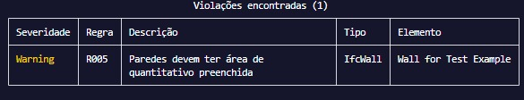
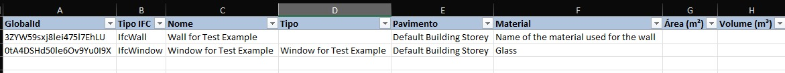

# BIM Insight


Ferramenta em C# para analisar modelos BIM no formato **IFC**: gera quantitativos, verifica a qualidade do modelo com regras configuráveis e exporta relatórios. Funciona sem Revit ou qualquer licença, usando o padrão aberto IFC.


## Funcionalidades

- **Leitura de IFC** com a biblioteca xBIM
- **Quantitativos** por tipo IFC, pavimento, tipo de elemento ou material (contagem, área e volume)
- **Verificador de regras** configurável em JSON (ex.: "toda parede deve ter material")
- **Exportação** para Excel (`.xlsx`, com várias abas), CSV e JSON
- **CLI** para uso rápido e **dashboard web** em Blazor

## Tecnologias

.NET 10, C#, xBIM Toolkit, ClosedXML, Spectre.Console, Blazor, xUnit, GitHub Actions

## Como rodar

Requisito: [.NET 10 SDK](https://dotnet.microsoft.com/download)

```bash
git clone https://github.com/santkraemer7/BimInsight.git
cd BimInsight
dotnet build
dotnet test
```

Coloque um arquivo `.ifc` na pasta `samples/` (veja `samples/README.md`).

### Linha de comando

```bash
# Quantitativos (ifc | storey | type | material)
dotnet run --project src/BimInsight.Cli -- samples/modelo.ifc storey

# Verificação de regras
dotnet run --project src/BimInsight.Cli -- check samples/modelo.ifc rules/regras-basicas.json

# Exportação (.xlsx, .csv ou .json)
dotnet run --project src/BimInsight.Cli -- export samples/modelo.ifc output/relatorio.xlsx rules/regras-basicas.json
```



O relatório em Excel gerado pelo comando `export`:



### Dashboard web

```bash
dotnet run --project src/BimInsight.Web
```

Abra o endereço mostrado no terminal e envie um arquivo `.ifc`.

## Regras personalizadas

As regras ficam em JSON (veja `rules/regras-basicas.json`):

```json
{
  "id": "R001",
  "description": "Paredes devem ter material definido",
  "ifcType": "IfcWall",
  "check": "HasMaterial",
  "severity": "Error"
}
```

Verificações disponíveis: `HasName`, `HasTypeName`, `HasMaterial`, `HasStorey`, `HasArea`, `HasVolume`. Use `"*"` em `ifcType` para valer para todos os elementos.

## Arquitetura

```
src/
├── BimInsight.Core        leitura do IFC e modelo de domínio
├── BimInsight.Quantities  cálculo de quantitativos
├── BimInsight.Rules       motor de regras
├── BimInsight.Export      Excel, CSV e JSON
├── BimInsight.Cli         linha de comando
└── BimInsight.Web         dashboard Blazor
tests/
└── BimInsight.Tests       testes unitários (xUnit)
```

Quantitativos, regras e exportação dependem só do modelo de domínio, não do xBIM. Só o `Core` conhece o formato IFC.

## Limitações

- As quantidades (área e volume) vêm das propriedades gravadas no IFC; não são calculadas a partir da geometria.
- O dashboard é pensado para uso local.

## Próximos passos

- Cálculo de quantidades pela geometria
- Mais tipos de verificação nas regras
- Plugin para Revit reaproveitando o `Core`

## Autor

Douglas Kraemer, [@santkraemer7](https://github.com/santkraemer7)

## Licença

MIT. Veja o arquivo [LICENSE](LICENSE).